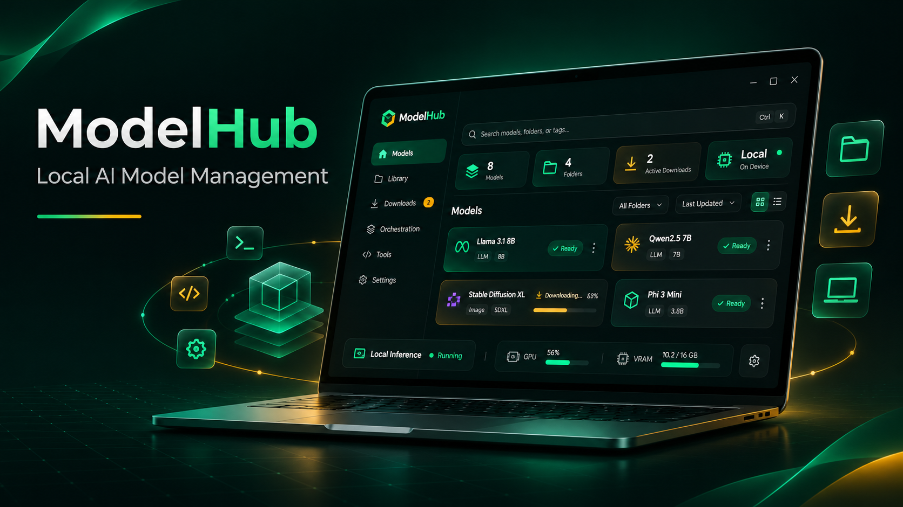

<p align="center">
  
</p>

<p align="center">
  
</p>

<p align="center">
  
  
  
  
  
  
</p>

#  ModelHub — Local AI Desktop App

**ModelHub** is a desktop application I built to make it easier to work with AI models running locally through [LM Studio](https://lmstudio.ai/). Instead of switching between LM Studio, API calls and scripts, I can manage models, send prompts and check their responses from one place.

It's built with **C#**, **.NET** and **Avalonia UI**. The focus is on being a useful tool for trying out different local models, rather than a platform tied to one particular AI task.

## 📋 What It Does

- **Manage local models** — See which models are available, load or unload them and check their status.
- **Run prompts** — Enter a prompt and view the response directly in the app.
- **Compare models** — Send the same prompt to multiple loaded models and look at their responses and response times.
- **Keep track of activity** — Use the logs to follow connections, model changes, requests and errors.
- **Work with image datasets** — Run prompts across folders of images with a compatible vision-language model and save the output as JSON.

The image workflow is optional. ModelHub can be used just for loading models, trying prompts and comparing results.

## 🖥️ The Interface

<p align="center">
  
</p>

The app has three main panels:

- **Models** lists the models available through LM Studio and lets me load or unload them.
- **Prompt Lab** is where I enter prompts, run them and read the responses. It also has options for selecting an image dataset.
- **Logs** shows what the app is doing, including connection messages and model activity.

The URL field at the top connects ModelHub to the local LM Studio server.

## 🛠️ Built With

- **C# / .NET 10** — Application logic
- **Avalonia UI** — Cross-platform desktop interface
- **MVVM / CommunityToolkit.Mvvm** — UI state and commands
- **LM Studio APIs** — Local model loading, unloading and inference
- **HTTP and JSON** — Requests, responses and saved dataset outputs

## 🚀 Getting Started

You'll need the **.NET 10 SDK**, [LM Studio](https://lmstudio.ai/) and at least one model installed in LM Studio.

1. Start LM Studio and enable its local server.
2. Clone this repository and run the app:

   ```bash
   git clone https://github.com/yuryk200/ModelHub.git
   cd ModelHub
   dotnet run --project ModelHub.csproj
   ```

3. Check that the LM Studio URL is correct (by default, `http://localhost:1234/v1`) and click **Test Connection**.
4. Load a model, enter a prompt in **Prompt Lab** and click **Run Prompt**.

ModelHub communicates with LM Studio through its API; it does not train models or host them independently. What you can run depends on the models installed in LM Studio and your machine's hardware.

## 🎓 How I Use ModelHub in My PhD Research

I use **ModelHub** as a supporting tool in my PhD research into **AI-driven residential building design and energy efficiency**. It provides a centralised interface for experimenting with locally hosted AI models, allowing me to manage models, test prompts, compare responses and evaluate their capabilities across different research tasks.

One application involves working with **multi-view residential building datasets**, where I use vision-language models to analyse images of houses and generate descriptive metadata. ModelHub allows me to automate this process by applying prompts across multiple images, collecting model responses and saving the results in structured JSON files for further analysis.

Beyond this specific workflow, ModelHub serves as a **flexible environment for testing and experimenting with local AI models**, allowing me to explore different approaches and integrate AI-generated outputs into my wider research.
