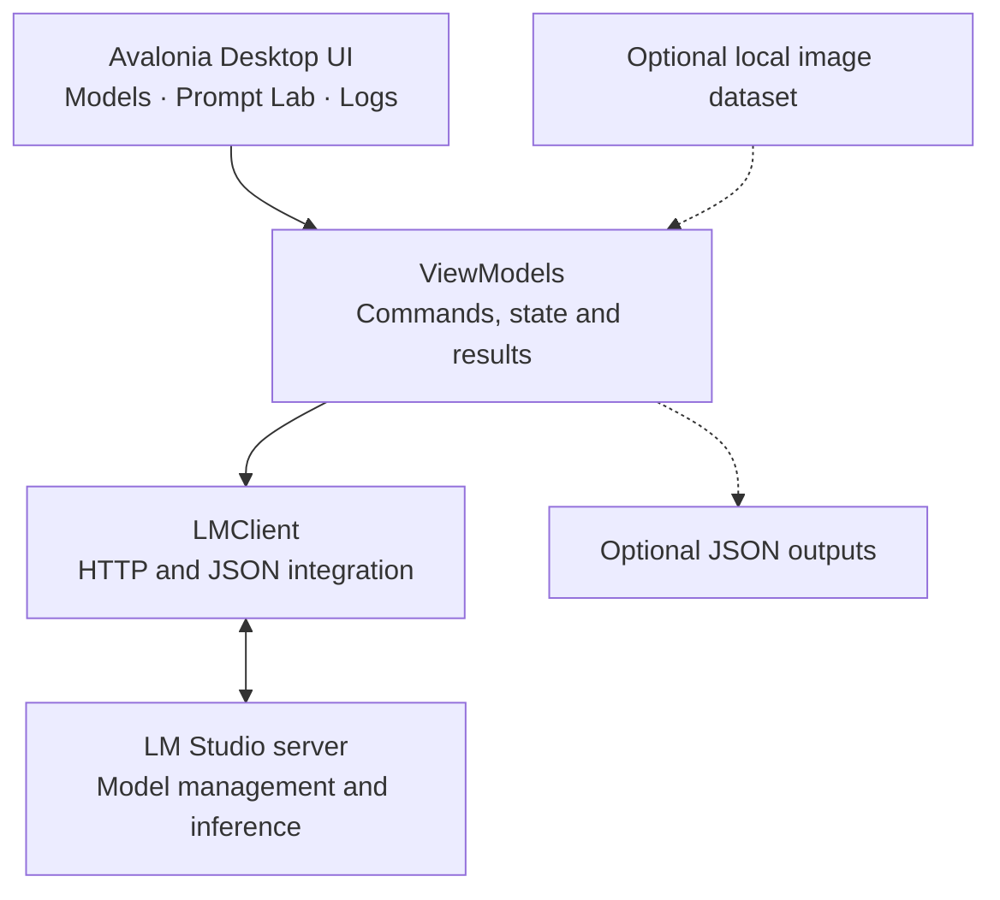

<p align="center">
  
</p>

<p align="center">
  
</p>

<p align="center">
  
  
  
  
  
  
</p>

#  ModelHub — Local AI Desktop Workbench

**ModelHub** is a desktop application for **managing, interacting with and experimenting with locally hosted AI models** from a single interface. Built with **C#**, **.NET 10** and **Avalonia UI**, it connects to [LM Studio](https://lmstudio.ai/) to bring model discovery, loading and unloading, prompt execution, response comparison and activity monitoring into one workspace.

Rather than focusing on one AI task, ModelHub provides a practical interface for working with different local models and testing their behaviour. Alongside its core model-management and prompting features, it can also run **optional dataset-based workflows**, including image analysis with vision-language models.

## 📋 Overview

ModelHub brings together several parts of local AI experimentation that would otherwise require switching between a model server, API requests and separate scripts.

### ✨ Key capabilities

- **Model discovery and status:** Retrieve available models from LM Studio and see which are loaded or ejected.
- **Model lifecycle management:** Load or unload models directly from the desktop application.
- **Prompt Lab:** Send text prompts to locally hosted models and inspect the returned output.
- **Multi-model prompting and comparison:** Run the same prompt against multiple loaded models and review their responses and execution times.
- **Monitoring and feedback:** View connection events, model activity, loading indicators, progress updates and errors in the interface.
- **Optional dataset workflows:** Apply a prompt to collections of images using a compatible vision-language model, with results saved to JSON files.

### 🔄 Typical workflow

1. Start **LM Studio** and enable its local API server.
2. Open ModelHub and use **Test Connection** to discover available models.
3. Load or unload models using the **Models** panel.
4. Enter a prompt in **Prompt Lab** and click **Run Prompt**.
5. Review responses, execution times and activity logs.
6. If needed, select a dataset to use the optional batch image-processing workflow.

## 📖 Table of Contents

- [Overview](#-overview)
- [System Architecture](#-system-architecture)
- [Technical Stack](#-technical-stack)
- [Demo and Interface](#-demo-and-interface)
- [Getting Started](#-getting-started)
- [LM Studio Integration](#-lm-studio-integration)
- [Prompt Lab and Model Comparison](#-prompt-lab-and-model-comparison)
- [Optional Workflow: Image Dataset Captioning](#-optional-workflow-image-dataset-captioning)
- [Project Structure](#-project-structure)
- [Current Scope and Notes](#-current-scope-and-notes)
- [Why I Built ModelHub and How I Use It](#-why-i-built-modelhub-and-how-i-use-it)

## 🏗 System Architecture

ModelHub is structured around an **Avalonia desktop interface** and the **MVVM pattern**. The UI exposes actions for model management and experimentation, view models coordinate application state and commands, and a service layer communicates with LM Studio over HTTP. Optional file-based workflows build on the same prompting functionality.



### 🖥️ Desktop Interface (Avalonia UI)

- **Models:** Displays detected models, loading state, and load/eject controls.
- **Prompt Lab:** Accepts prompt text and runs it against loaded models, with optional dataset and image-view settings.
- **Prompt Response:** Shows generated content, request status and elapsed time.
- **Logs and status bar:** Report connection attempts, model operations, progress and errors.

### 🔌 LM Studio Integration (HTTP | JSON)

- Uses LM Studio's **native API** to discover models and manage loaded instances.
- Uses its **OpenAI-compatible chat completions API** for text and supported image prompts.
- Parses the resulting outputs and exposes them through the application interface.

### 🗂️ Optional File-Based Processing

- Can read image collections from local folders for prompts that involve visual data.
- Supports `.png`, `.jpg`, `.jpeg` and `.webp` images.
- Can save generated captions into per-item metadata and a combined JSON file.

These file-processing features are an **extension of the general prompting workflow**, not a requirement for using ModelHub.

## 📚 Technical Stack

| Layer | Technology | Role |
| --- | --- | --- |
| Application | C# / .NET 10 | Desktop runtime and application logic |
| UI framework | Avalonia UI 12 | Desktop interface using AXAML |
| Architecture | MVVM / CommunityToolkit.Mvvm | Command bindings, observable state and view-model separation |
| AI model service | LM Studio | Hosting models and providing local inference APIs |
| API integration | `HttpClient` / JSON | Model management and inference requests |
| Prompting | Chat completions API | Text and supported multimodal model interaction |
| Optional data handling | `System.IO` / `System.Text.Json` | Scanning image folders and writing JSON results |

## 🎬 Demo and Interface

**Current application interface:**

<p align="center">
  
</p>

The application is divided into three main areas: **Models** on the left, **Prompt Lab** in the centre and **Logs** on the right. The connection controls sit above these panels, while the status bar shows the current operation.

> The top banner is a conceptual illustration; the image above is a screenshot of the desktop application.

## 🚀 Getting Started

### Prerequisites

- **.NET 10 SDK** installed.
- [LM Studio](https://lmstudio.ai/) installed with its local API server running.
- At least one model available in LM Studio. For image-based prompts, use a compatible **vision-language model**.

### 1. Clone the repository

```bash
git clone https://github.com/yuryk200/ModelHub.git
cd ModelHub
```

### 2. Restore and run

```bash
dotnet restore ModelHub.csproj
dotnet run --project ModelHub.csproj
```

To build a release version:

```bash
dotnet build ModelHub.csproj -c Release
```

### 3. Connect to LM Studio

Enable the local API server inside LM Studio, or use the `lms` CLI if it is available:

```bash
lms server start
```

The default server URL in ModelHub is:

```text
http://localhost:1234/v1
```

Enter a different URL if your server uses a different host or port, then click **Test Connection**.

### 4. Work with a model

1. Locate a model in the **Models** panel and click **Load** if necessary.
2. Enter a prompt in **Prompt Lab**.
3. Select **Run Prompt**.
4. Review the response, timing and log entries.

> Inference speed and supported input types depend on the selected model and the resources available on your machine.

## 🖧 LM Studio Integration

ModelHub makes requests to two LM Studio API interfaces:

| Operation | Endpoint |
| --- | --- |
| Discover local models and loaded instances | `GET /api/v1/models` |
| Load a model | `POST /api/v1/models/load` |
| Unload a model instance | `POST /api/v1/models/unload` |
| Execute text or supported image prompts | `POST /v1/chat/completions` |

For the default `http://localhost:1234/v1` URL, model-management requests use `http://localhost:1234/api/v1`, while prompting uses the `/v1/chat/completions` endpoint.

ModelHub is a **client for local AI models**. It does not train models or download their weights itself.

## 💬 Prompt Lab and Model Comparison

The **Prompt Lab** is designed for interacting with different models without leaving the application.

- **One loaded model:** Send a prompt and display its generated response.
- **Multiple loaded models:** Run the same prompt against each loaded model in sequence and display their responses together.
- **No loaded models:** Prompt the user to load a model before running inference.

For each request, ModelHub displays the result or error and records elapsed time. This makes it useful for **exploratory comparisons** between models, although it is not a formal benchmarking or accuracy-evaluation system.

## 🖼️ Optional Workflow: Image Dataset Captioning

ModelHub also supports **batch image processing using vision-language models**. The current implementation was developed around datasets of multi-view residential images: it applies the user's prompt to images in each house folder and saves the output as captions.

This is **one practical application of the workbench**, rather than its overall purpose.

### Example dataset structure

```text
dataset-root/
├── house_001/
│   ├── rgb/
│   │   ├── view_000.png
│   │   ├── view_001.png
│   │   └── ...
│   └── meta.json              # Created if missing
├── house_002/
│   └── rgb/
│       └── view_000.png
└── ...
```

### Running this workflow

1. Select **Browse Dataset** and choose a root folder containing house subfolders.
2. Enter instructions in **Prompt Lab**.
3. Set the **Views** value to limit how many images are sent per house (the default is `10`).
4. Load a compatible vision-language model and select **Run Prompt**.
5. ModelHub processes the house folders and records the generated descriptions.

For successful requests, results are written to:

- `<house>/meta.json` as a `caption` field, preserving existing metadata when it can be parsed.
- `dataset-root/captions_modelhub.json` as a combined mapping of house names to captions.

**Important:** This workflow creates or updates files, including overwriting existing `caption` fields. Back up any important dataset metadata before running it. Folder processing is sequential, and image support depends on the selected model.

## 📁 Project Structure

```text
ModelHub/
├── Assets/             # Application resources
├── Controls/           # Reusable UI controls
├── Models/             # Model and result data types
├── Services/           # LM Studio integration
├── ViewModels/         # Commands and application state
├── Views/              # Avalonia windows and layouts
├── App.axaml
├── App.axaml.cs
├── ModelHub.csproj
├── Program.cs
└── README.md
```

## 🔥 Current Scope and Notes

- ModelHub currently integrates with **locally hosted models via LM Studio**, not cloud-hosted APIs.
- It supports model management, text prompting, multi-model response inspection and an optional vision-based dataset workflow.
- The comparison feature displays responses and elapsed time; it does not calculate independently verified model-quality scores.
- The application is a development-stage desktop project; this README does not include a packaged installer or video walkthrough.

## 💡 Why I Built ModelHub and How I Use It

ModelHub originally began as a **practical C#/.NET desktop engineering-tools project** while I was preparing for a software engineering interview. I wanted to build something I could demonstrate and use, combining desktop application development with my background in artificial intelligence rather than creating a purely illustrative example.

I started by connecting an **Avalonia UI** application to **LM Studio**, so I could discover locally available models, control what was loaded and send prompts through a simple interface. From there, I expanded the application to support **comparing responses from multiple loaded models** and monitoring operations through logs and status updates. That made it more useful as a general-purpose tool for experimenting with local AI systems.

I later used it in my **PhD research into AI-driven residential building design**. One use case involved testing vision-language models on datasets containing several images of each house. Instead of sending each image manually, I added a workflow that could run a prompt across image folders and save the descriptions back into structured JSON metadata.

That research-specific functionality helped shape ModelHub, but **it is not what defines the application**. ModelHub is a reusable workspace for working with different locally hosted models, with dataset processing as one example of how its capabilities can be applied to a real project.
