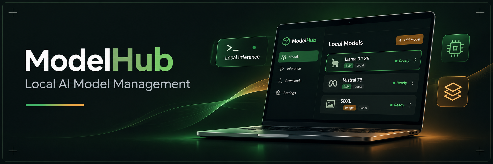
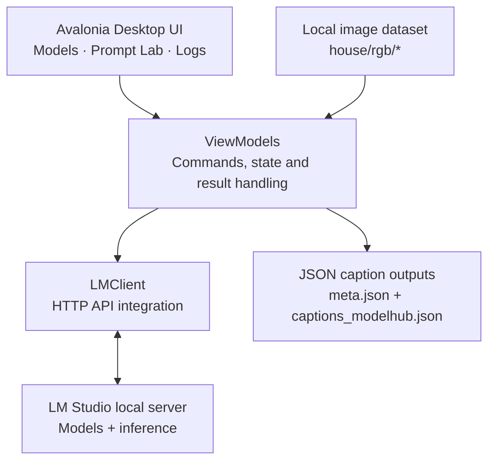
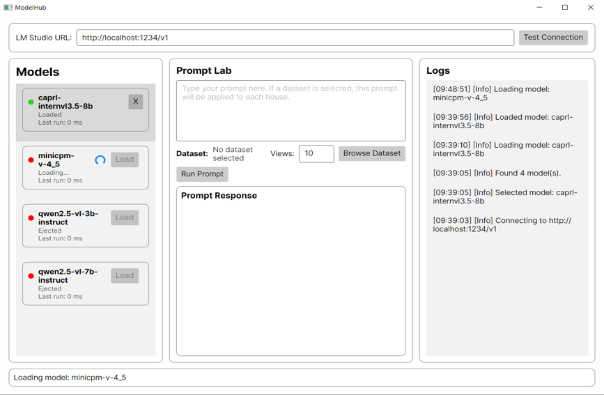

<p align="center">
  
</p>

<p align="center">
  
</p>

<p align="center">
  
  
  
  
  
  
</p>

#  ModelHub — Local AI Model Management

**ModelHub** is a desktop application for discovering, loading, running and comparing **locally hosted AI models** through [LM Studio](https://lmstudio.ai/). Built with **C#**, **.NET 10** and **Avalonia UI**, it provides a single workspace for model management, text prompting, model-response comparisons and vision-based dataset captioning.

The aim is to make local model experimentation easier to manage: connect to a running LM Studio server, choose which models are loaded, send prompts, inspect responses and timing, and apply a vision-capable model to an organised dataset of images.

## 📋 Overview

**How it works — workflow:**

1. Start **LM Studio** and enable its local API server.
2. Launch ModelHub and use **Test Connection** to retrieve the available models.
3. Load or unload a model using the controls in the **Models** panel.
4. Enter a prompt in **Prompt Lab** and select **Run Prompt**.
5. Review the generated response, per-model elapsed time, status and logs.
6. Optionally select a dataset folder to run a vision-language prompt across house-image folders and save the resulting captions as JSON.

### ✨ Key features

- **Local model discovery:** Lists models reported by the LM Studio native API and shows loaded/ejected status.
- **Model lifecycle controls:** Load and unload models without leaving ModelHub.
- **Prompt Lab:** Run text prompts against a loaded local model.
- **Multi-model comparison:** When multiple models are loaded, run the same prompt against each and view their responses and execution times together.
- **Vision dataset captioning:** Apply one prompt to multiple image views per house using a compatible vision-language model.
- **Execution feedback:** Loading spinners, status messages and an in-app activity log for successful operations and errors.

## 📖 Table of Contents

- [Overview](#-overview)
- [System Architecture](#-system-architecture)
- [Technical Stack](#-technical-stack)
- [Demo and Interface](#-demo-and-interface)
- [Getting Started](#-getting-started)
- [LM Studio Integration](#-lm-studio-integration)
- [Prompt Lab and Model Comparison](#-prompt-lab-and-model-comparison)
- [Vision Dataset Captioning](#-vision-dataset-captioning)
- [Project Structure](#-project-structure)
- [Current Scope and Notes](#-current-scope-and-notes)

## 🏗 System Architecture

ModelHub uses an **Avalonia desktop interface** with an MVVM-based application structure. The view models manage user interaction, observable state and the command workflow; the service layer handles requests to LM Studio, and local file processing handles optional dataset captioning outputs.



### 🖥️ Desktop Interface (Avalonia UI)

- **Models:** Displays model names, loading state and load/eject controls.
- **Prompt Lab:** Accepts prompt text, an optional dataset path and a maximum number of image views per house.
- **Prompt Response:** Displays model output, success status and elapsed time for each run.
- **Logs and status bar:** Show connection events, model lifecycle events, progress and errors.

### 🔌 Service Layer (LM Studio | HTTP)

- Retrieves model details and manages loaded model instances using LM Studio's **native API**.
- Sends text and image prompts to LM Studio's **OpenAI-compatible chat completions endpoint**.
- Converts API responses into application-level results, including success, error messages and execution time.

### 🗂️ Dataset Processing (File System | JSON)

- Reads images from house-specific `rgb/` folders.
- Supports common image formats: `.png`, `.jpg`, `.jpeg` and `.webp`.
- Sends multiple views in a single vision prompt, with a configurable view limit per house.
- Writes a `caption` field into each house's `meta.json` and saves a dataset-level `captions_modelhub.json` summary.

## 📚 Technical Stack

| Layer | Technology | Role |
| --- | --- | --- |
| Desktop application | C# / .NET 10 | Application logic and runtime |
| UI framework | Avalonia UI 12 | Desktop interface using AXAML |
| App architecture | MVVM / CommunityToolkit.Mvvm | Observable state and command binding |
| Local model service | LM Studio | Model loading, unloading and inference |
| API integration | `HttpClient` / JSON | HTTP requests and response parsing |
| Text and vision inference | Chat completions API | Local prompts and image-based captioning |
| Local data | `System.IO` / `System.Text.Json` | Dataset scanning and metadata output |

## 🎬 Demo and Interface

**Current application interface:**

<p align="center">
  
</p>

The interface is organised into three main panels: **Models** on the left, **Prompt Lab** in the centre and **Logs** on the right. The top bar controls the LM Studio connection, and the bottom bar reports the current operation.

> The banner is a conceptual project illustration; the screenshot above shows the actual application interface. A video walkthrough has not yet been added.

## 🚀 Getting Started

### Prerequisites

- The **.NET 10 SDK** installed on your machine.
- [LM Studio](https://lmstudio.ai/) installed and running locally.
- At least one compatible model available in LM Studio. For dataset captioning, use a **vision-language model that can accept image inputs**.

### 1. Clone the repository

```bash
git clone https://github.com/yuryk200/ModelHub.git
cd ModelHub
```

### 2. Restore and run

```bash
dotnet restore ModelHub.csproj
dotnet run --project ModelHub.csproj
```

To compile a release build:

```bash
dotnet build ModelHub.csproj -c Release
```

### 3. Start the LM Studio server

Enable the local API server within LM Studio. Alternatively, if you have its `lms` command-line tool available:

```bash
lms server start
```

The application's default **LM Studio URL** is:

```text
http://localhost:1234/v1
```

If you use a different host or port, update the URL field in ModelHub. Press **Test Connection** to retrieve the model list.

### 4. Run a prompt

1. Select a model in the **Models** panel and click **Load** if it is not loaded.
2. Enter your prompt in the **Prompt Lab** text area.
3. Click **Run Prompt** to send the prompt to the currently loaded models.
4. Review each response and its elapsed time in **Prompt Response**.

> Running inference depends on the model's capabilities, the resources available on your machine and a responsive LM Studio server.

## 🖧 LM Studio Integration

ModelHub communicates with **two LM Studio API surfaces**, both derived from the URL entered at the top of the application:

| Operation | Endpoint |
| --- | --- |
| List local models and loaded instances | `GET /api/v1/models` |
| Load a model | `POST /api/v1/models/load` |
| Unload a model instance | `POST /api/v1/models/unload` |
| Text prompts and image prompts | `POST /v1/chat/completions` |

For the default `http://localhost:1234/v1` setting, model-management requests use the native API under `http://localhost:1234/api/v1`, while inference requests use the OpenAI-compatible `/v1/chat/completions` route.

ModelHub sends requests to your configured LM Studio server; it does **not** train models or download model weights itself.

## 💬 Prompt Lab and Model Comparison

When a standard text prompt is submitted **without a dataset selected**, ModelHub checks which models are loaded:

- **One loaded model:** The prompt runs once and displays a single-model response.
- **Multiple loaded models:** The same prompt is sent to each loaded model in sequence, and the responses are displayed together.
- **No loaded model:** The application asks you to load a model before proceeding.

For each run, the UI records whether the request succeeded, the generated response or error, and the elapsed time in milliseconds. This supports basic side-by-side inspection of local model responses; it is **not an automated accuracy benchmark**.

## 🖼️ Vision Dataset Captioning

ModelHub also supports an optional dataset workflow designed for collections of **multi-view house images**. When a dataset folder is selected, the prompt is applied to each house folder using a loaded **vision-capable model**.

### Expected dataset structure

```text
dataset-root/
├── house_001/
│   ├── rgb/
│   │   ├── view_000.png
│   │   ├── view_001.png
│   │   └── ...
│   └── meta.json              # Optional: created if missing
├── house_002/
│   └── rgb/
│       ├── view_000.png
│       └── ...
└── ...
```

### How the captioning pipeline works

1. Select **Browse Dataset** and choose the root folder containing house subfolders.
2. Enter captioning instructions in the **Prompt Lab**.
3. Set **Views** to the maximum number of images to use from each house (the initial value is `10`).
4. Ensure a vision-language model is loaded, then click **Run Prompt**.
5. ModelHub reads images from each house's `rgb/` folder, sends the images and prompt to LM Studio and records the returned text.
6. Successful captions are written to two locations:
   - `<house>/meta.json`, in a `caption` field (existing metadata is retained where it can be parsed).
   - `dataset-root/captions_modelhub.json`, containing a house-name-to-caption mapping.

**Important:** Captioning **modifies `meta.json` files** by adding or replacing their `caption` field. Keep a backup of important datasets before running this workflow. Image support and performance depend on the chosen local vision model. The current pipeline processes house folders sequentially.

## 📁 Project Structure

```text
ModelHub/
├── Assets/             # Application resources
├── Controls/           # Reusable UI controls
├── Models/             # Model and result data types
├── Services/           # LM Studio API integration
├── ViewModels/         # MVVM command and state logic
├── Views/              # Avalonia windows and layout
├── App.axaml
├── App.axaml.cs
├── ModelHub.csproj
├── Program.cs
└── README.md
```

## 🔥 Current Scope and Notes

- ModelHub currently focuses on **local LM Studio integration**, rather than cloud-hosted AI APIs or model training.
- The application includes **text prompting, multi-model response comparison and dataset captioning**; the vision workflow requires a supported vision-language model.
- Model comparisons show **responses and elapsed time**, not externally validated accuracy scores.
- The interface shown here is an actual development screenshot. No packaged installer or video demo is supplied in this README.

---

<sub>Developed as a software engineering and local AI experimentation project. See the [repository](https://github.com/yuryk200/ModelHub) for implementation details.</sub>
